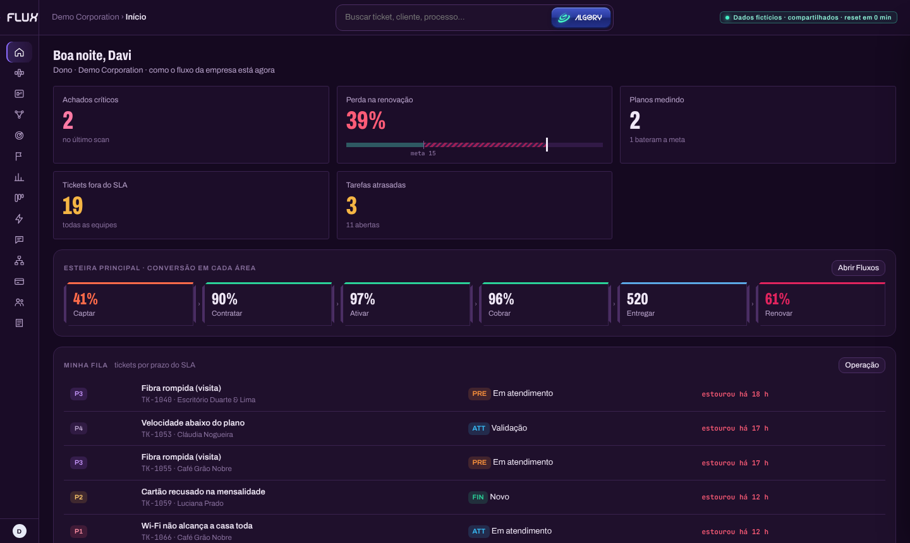

# Flux · demo pública

O Flux é o gestor de processos que eu desenvolvo na Osmio. Ele mostra como a empresa funciona de verdade: os fluxos de cada área, quem faz cada etapa, onde o trabalho trava e quanto dinheiro está em jogo em cada gargalo. Depois ajuda a corrigir: plano de ação, meta, medição e o Algory, o agente da página, explicando cada tela. Este repositório documenta a demonstração pública, que roda com dados fictícios.

Demo: https://demoflux.osmio.tech

## Funcionalidades

- **Cadeia de fluxos.** A empresa vista como uma esteira: Captar, Contratar, Ativar, Cobrar, Entregar e Renovar, com a conversão medida em cada passagem e os fluxos de apoio ligados à esteira principal.
- **Construtor livre.** O usuário monta o próprio fluxo como quem monta um circuito: escreve a etapa, arrasta para a tela e liga saída com entrada. Qualquer lado do cartão pode ser entrada ou saída, e etapas podem andar em conjunto.
- **Algory monta o fluxo.** A pessoa descreve o processo em poucas respostas e o Algory devolve o desenho pronto, conferido no servidor antes de entrar na tela.
- **Operação medida.** Tickets em quadro, tarefas, SLA por equipe e tempos tirados do histórico, não digitados.
- **Mapa de equipes.** Empresa no topo, heads, cargos e quem responde a quem, com a carga de cada pessoa.
- **Scan do fluxo.** Uma varredura que acha os pontos onde a empresa perde dinheiro, com valor por mês e prioridade.
- **Planos de ação e metas.** Cada achado vira plano, cada plano tem meta e a meta é medida sobre a mesma base.
- **FluxMessage e FluxFinance.** Exemplo de gestão do fluxo de contato (WhatsApp, modelos da Meta, tempo de retorno) e leitura do caixa previsto contra o realizado.
- **Integração com o Quasar.** O comercial (Quasar) e a operação (Flux) da mesma empresa conversam por eventos assinados, sem banco compartilhado.
- **Três idiomas.** Português, inglês e espanhol, e o Algory percebe em qual idioma a pessoa escreve.

## As partes

| | Parte | |
|---|---|---|
| 1 | [Demo](docs/01-demo/) | como entrar, papéis, o reset de hora em hora, o que é real e o que é simulado |
| 2 | [Processos](docs/02-processos/) | cadeia de fluxos, fluxos por área, catálogo |
| 3 | [Construtor livre](docs/03-construtor/) | montagem por cartões, ligações, o Algory montando o fluxo |
| 4 | [Operação e equipes](docs/04-operacao/) | tickets, tarefas, SLA, mapa de equipes |
| 5 | [Melhoria contínua](docs/05-melhoria/) | scan, planos de ação, medição e metas |
| 6 | [Módulos](docs/06-modulos/) | FluxMessage e FluxFinance |
| 7 | [Algory](docs/07-algory/) | o agente da página: árvore primeiro, IA depois, custos e limites |
| 8 | [Integração com o Quasar](docs/08-integracao-quasar/) | eventos assinados entre operação e comercial |
| 9 | [Documentação técnica](docs/09-tecnico/) | arquitetura, por que cada ferramenta, dados, testes |
| 10 | [Segurança](docs/10-seguranca/) | o que foi fechado antes de abrir a demo |

## Os outros projetos

O Flux faz parte de um conjunto que eu mantenho na Osmio:

- **Quasar** (https://demoquasar.osmio.tech): ERP comercial, do lead ao primeiro pagamento. É o comercial da mesma empresa fictícia. Veja o [repositório](https://github.com/morigan-cybsec/quasar-demo) e a [integração](docs/08-integracao-quasar/).
- **Algory** (https://algory.osmio.tech): agente de IA que é produto próprio. O Algory que vive dentro do Flux segue o mesmo plano, aplicado a um gestor de processos.

## Como usar a demo

1. Abra https://demoflux.osmio.tech no computador.
2. Não há senha. Você entra como Davi (dono) e pode trocar para Renata (supervisora) ou Carla (consultora) no perfil.
3. Siga a Boas-vindas ou abra o Algory e peça "Me guie".
4. O que você fizer é real dentro da demo, é visto pelos outros visitantes e volta ao estado inicial a cada hora.

| | |
|---|---|
| Real (código de produção) | medição, cadeia de fluxos, construtor, tickets, tarefas, metas, scan, regras de cargo, eventos com o Quasar |
| Simulado | FluxMessage (contatos e disparos de exemplo) e as integrações de e-mail e planilha, que só funcionam com chave no servidor |
| Fora | envio real de WhatsApp e cobrança real |

## Uso de IA e custo

A demo é pública e a IA sai do meu bolso. Por isso o Algory responde primeiro com uma árvore de perguntas que lê a base, sem modelo, e só chama a IA depois dela:

- árvore de no máximo 7 passos antes da IA;
- Claude Haiku como modelo principal, com verba de US$ 5 por mês;
- 30 perguntas por hora por visitante, por 3 dias;
- Groq e Gemini como reserva, e a árvore quando tudo acaba.

Os detalhes estão em [Algory › Gestão dos tokens](docs/07-algory/#gestão-dos-tokens).

## Políticas

- **Licença:** todos os direitos reservados. O conteúdo pode ser lido para avaliação; uso, cópia ou reprodução precisam de autorização por escrito. Veja [LICENSE](LICENSE).
- **Dados:** tudo é fictício. Não coloque dados reais; a base é refeita de hora em hora.
- **Segurança:** se achar algo, abra uma issue ou escreva para mail@osmio.tech. Não rode ferramenta de carga contra a demo: há limite por IP e a VPS é compartilhada.
- **Contribuições:** repositório de portfólio, sem pull requests. Sugestões por issue são bem-vindas.
- **Código-fonte:** não é publicado. Uma avaliação técnica do código pode ser combinada comigo.

## Stack

Python 3.12, FastAPI, PostgreSQL 16, HTML/CSS/JS sem framework, Docker rootless, nginx, Claude Haiku, Groq (gpt-oss) e Gemini no Algory, Playwright nos testes. O porquê de cada escolha está na [documentação técnica](docs/09-tecnico/#2-por-que-essas-ferramentas).

## Autor

Morigan Ventrici. Contato: mail@osmio.tech

© 2026 Morigan Ventrici. Todos os direitos reservados.
