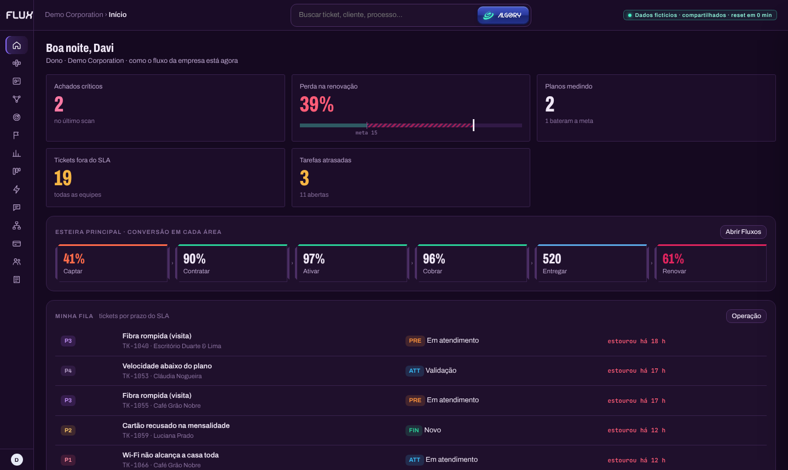

# 1 · A demo

A demo mostra a Demo Corporation, um provedor de internet por fibra fictício, com 557 assinantes, 7 equipes e 18 pessoas. É a mesma empresa que aparece no [Quasar](https://github.com/morigan-cybsec/quasar-demo): lá está o comercial, aqui está a operação.

## Como entrar

Não há senha. A demo abre como **Davi**, o dono, e no perfil dá para trocar para **Renata** (supervisora) ou **Carla** (consultora). O cargo vem da sessão no servidor, não da tela: o que cada um pode fazer (mover ticket, fechar caso, aposentar pessoa) é conferido na API.

## A base é compartilhada

Todos os visitantes veem a mesma base. Se alguém move um ticket, o outro vê. Para isso não virar bagunça:

- a base volta ao estado inicial a cada hora cheia (o selo no topo mostra quanto falta);
- cada endereço tem limite de mudanças em sequência;
- a criação de empresa nova tem limite por dia.

## Início

A primeira tela responde "como o fluxo da empresa está agora": achados críticos do último scan, perda na renovação contra a meta, tickets fora do SLA, tarefas atrasadas, a conversão em cada área da esteira principal e a fila da pessoa logada. Nada ali é número fixo: tudo é calculado pelo motor de medição na hora em que a tela abre.

## Empresa nova

Pela Boas-vindas dá para começar uma empresa do zero. Nessa versão, o que vale é o Início com checklist, os modelos, o construtor livre, o mapa de equipes vazio, os planos e o perfil.

## Idiomas

Português, inglês e espanhol, inclusive as perguntas da árvore do Algory. Se a pessoa escreve num idioma diferente do da demo, o Algory percebe e pergunta se quer trocar.
