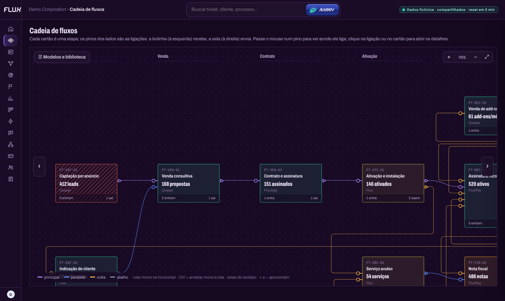
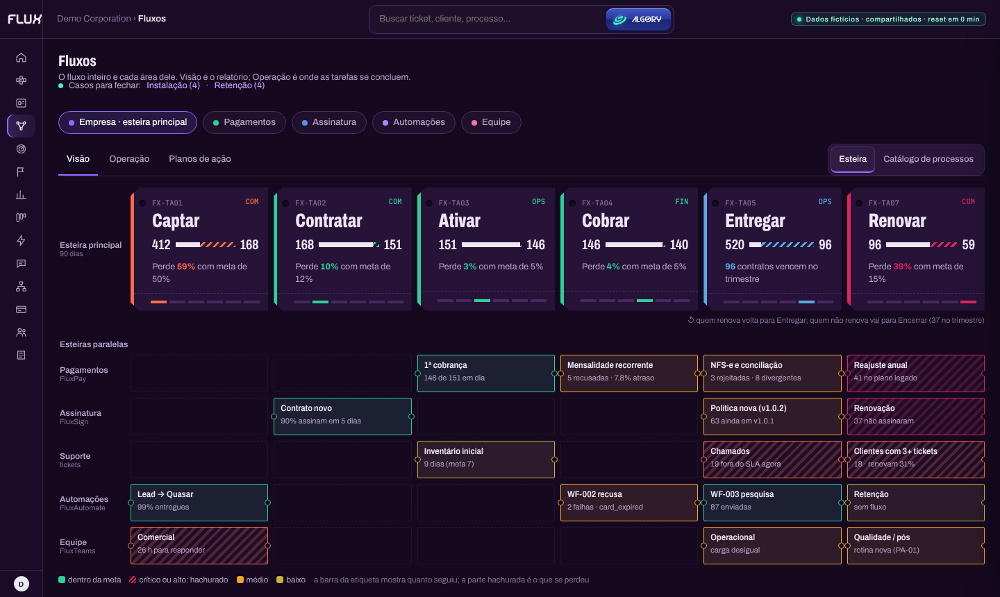

# 2 · Processos

## Cadeia de fluxos

A empresa vista como uma esteira: **Captar → Contratar → Ativar → Cobrar → Entregar → Renovar**. Cada passagem mostra quantos entraram, quantos saíram e a conversão. Os fluxos de apoio (pagamentos, assinaturas, suporte, automações) aparecem ligados ao ponto da esteira que eles alimentam.

## Fluxos

A mesma empresa por área. Cada cartão da esteira mostra o volume, a perda e a meta; abaixo ficam os fluxos paralelos e os pontos marcados como gargalo. Em "Casos para fechar" ficam os processos que dependem de uma decisão humana, como concluir uma instalação ou registrar se o cliente cancelou ou ficou. Fechar esses casos gera eventos para o Quasar.

## Catálogo de processos

Os modelos prontos (instalação, cobrança recorrente, retenção, atendimento) que servem de ponto de partida para uma empresa nova e para o construtor livre.
