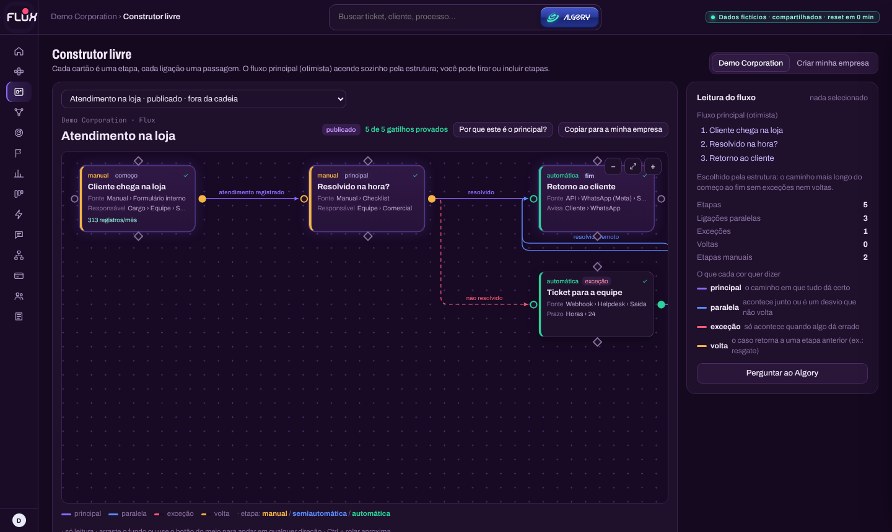

# 3 · Construtor livre

O construtor é onde o usuário monta o próprio processo. A inspiração foi montagem de circuito (o Tinkercad, por exemplo): a peça nasce de um texto, vai para a bancada e é ligada às outras.

## Como monta

- **Texto vira cartão.** Escreve-se a etapa e ela aparece como peça; arrasta-se para a tela.
- **Etapa nova nasce solta.** Sem ligação, ela fica livre até alguém ligar.
- **Ligar com cliques.** Clica-se numa saída e depois numa entrada. Há um "+" no próprio cartão para criar nova saída ou entrada.
- **Qualquer lado serve.** Os quatro lados do cartão são neutros: a lateral pode ser entrada ou saída, e cima e baixo também. Ligações secundárias têm traço diferente da principal.
- **Etapas em conjunto.** Duas etapas podem acontecer juntas, sem uma depender da outra.
- **Um cartão nunca fica dentro de outro.** Ao soltar, a peça encaixa no espaço livre mais próximo.
- **Linhas que não cruzam cartões.** O traçado é ortogonal e calculado por busca de caminho (A*) numa grade de corredores entre os cartões.
- **Navegação.** Botão do meio arrasta a tela, a tela cresce para cima e para baixo, Delete ou Backspace remove a ligação selecionada.

## A etapa

Clicar numa etapa abre um modal no centro, com responsável, prazo, gatilho e regra. As escolhas são feitas em modais com subtítulos, não em listas suspensas. Se o Algory for chamado, ele aparece ao lado e empurra o modal.

## O Algory monta o fluxo

A pessoa responde poucas perguntas (o ramo, por onde o cliente chega, como cobra, as etapas que já conhece) e o Algory devolve um rascunho com etapas e ligações. O servidor confere o rascunho antes de ele entrar na tela: formato, quantidade de etapas, ligações válidas. Se não passar, nada é criado.
