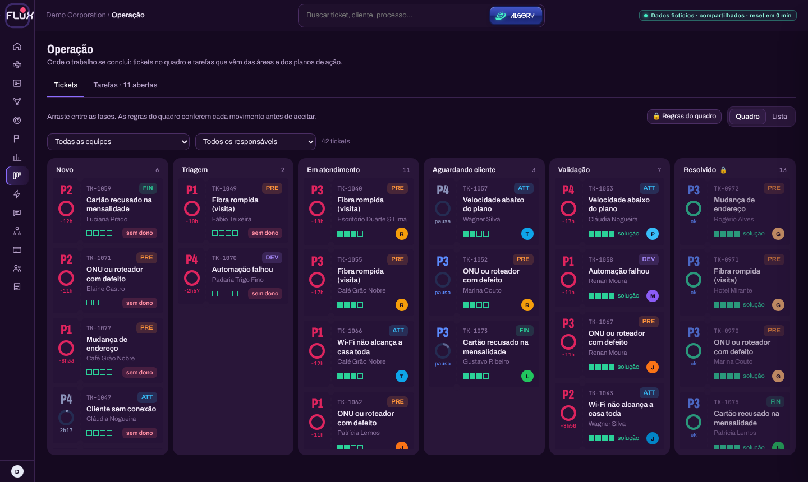
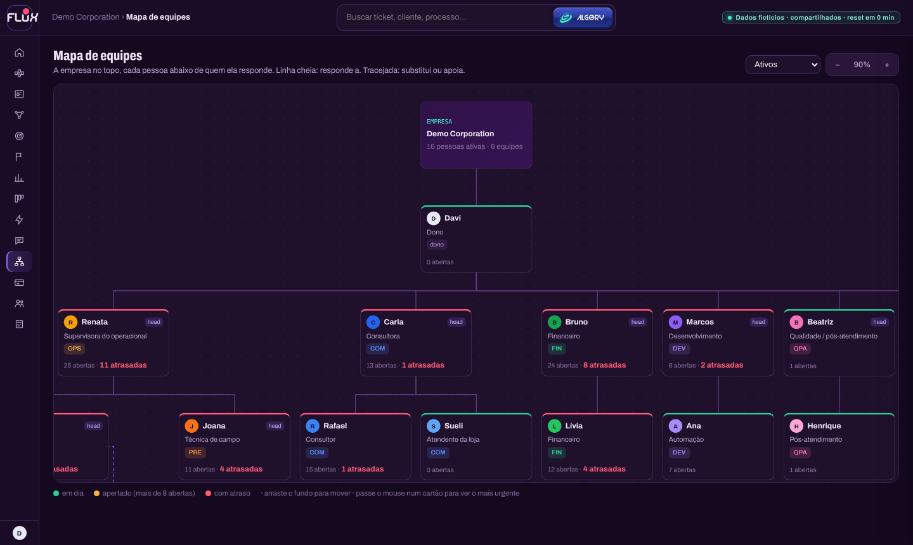

# 4 · Operação e equipes

## Operação

Tickets em quadro por fase (novo, triagem, atendimento, aguardando cliente, validação, resolvido), com prioridade, equipe, responsável e prazo de SLA. Mover um ticket passa pelas regras do quadro no servidor:

- só existem os caminhos desenhados no quadro;
- não entra em atendimento sem responsável;
- não vai para validação sem cumprir os passos do guia e registrar a solução;
- quem resolveu não valida o próprio ticket;
- resolvido é final: para voltar, abre-se um ticket novo ligado ao anterior. A aba de tarefas mostra o que cada equipe tem para hoje.

Os tempos (até a triagem, até ter dono, até resolver) são medidos no histórico dos próprios tickets, não digitados.

## Mapa de equipes

A empresa no topo, os heads, os cargos únicos (como o zelador) e quem responde a quem. Cada pessoa mostra a carga e as tarefas atrasadas. Aposentar alguém mantém o histórico.

## Automações

Gatilhos manuais e por webhook: o que acontece sozinho quando um evento chega (de outro sistema, de uma planilha, do Quasar).
