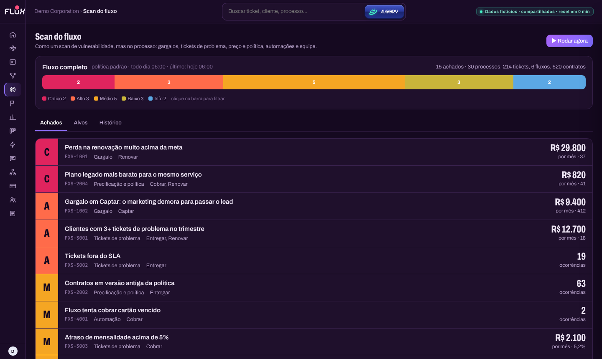
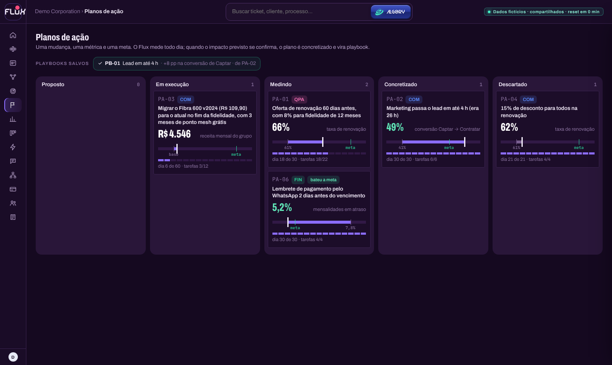
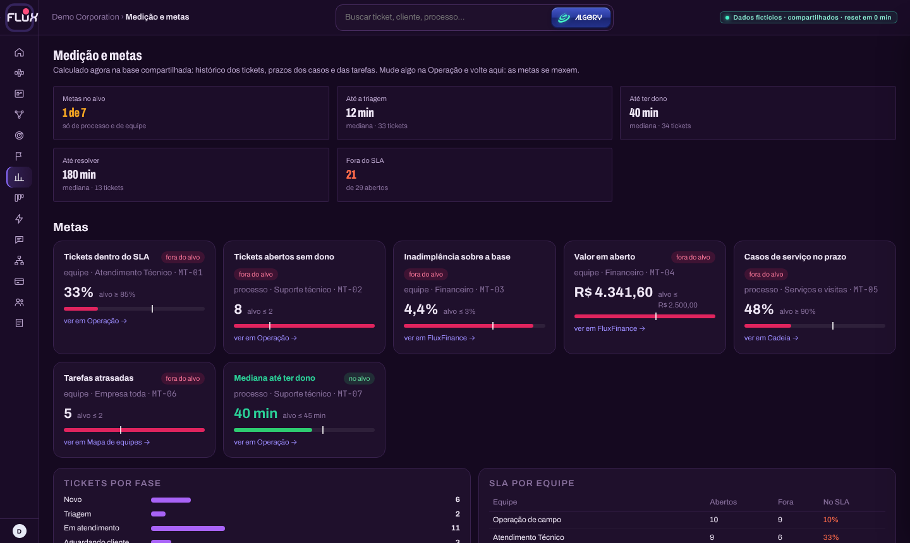

# 5 · Melhoria contínua

O Flux não para em mostrar o processo: ele acha onde a empresa perde e acompanha a correção.

## Scan do fluxo

Uma varredura sobre a base que classifica os achados por gravidade e por dinheiro em jogo por mês: perda na renovação acima da meta, gargalo entre áreas, clientes com muitos tickets, atraso de mensalidade. Cada achado diz em que fluxo está e se já tem plano.

## Planos de ação

Cada achado vira plano, e o plano anda por proposto, em execução, medindo, concretizado ou descartado. Um plano só é concretizado quando a meta é batida na medição, não quando alguém marca como feito.

## Medição e metas

As metas (tickets dentro do SLA, tickets sem dono, inadimplência, casos no prazo, tarefas atrasadas, tempo até ter dono) são calculadas sobre a mesma base que as telas usam. Cada meta leva para a tela onde o número nasce.

