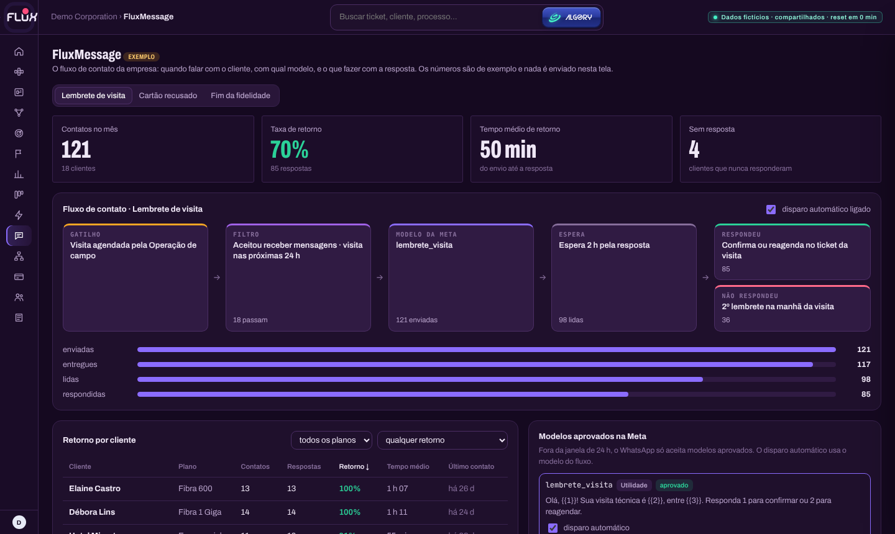
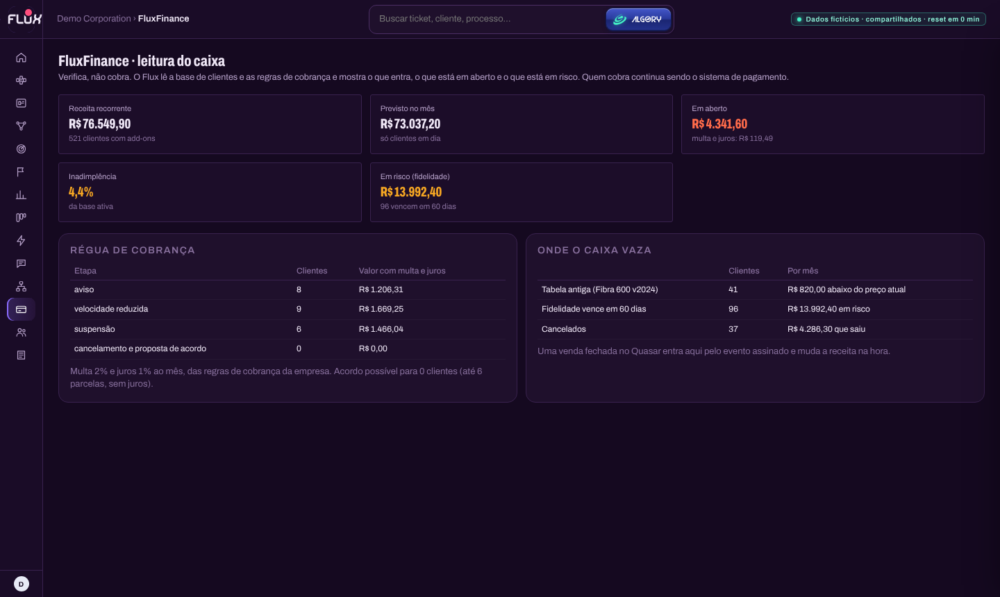

# 6 · Módulos

## FluxMessage

Um gerenciador do fluxo de contato da empresa, mostrado na demo como exemplo. Registra a quantidade de contatos, a taxa de retorno, o tempo médio de retorno e o retorno por cliente, com filtros no fluxo e disparos automáticos de modelos aprovados da Meta.

Na demo os números são de exemplo. Num cliente real, o Flux se liga à API do WhatsApp Business: faz as requisições de envio e recebe os webhooks de entrega, leitura e resposta, que viram os registros dessa tela.

## FluxFinance

A leitura do caixa: previsto contra realizado, inadimplência, valores em aberto, a régua de cobrança e onde o caixa vaza. O FluxFinance verifica o caixa; ele não movimenta dinheiro.

