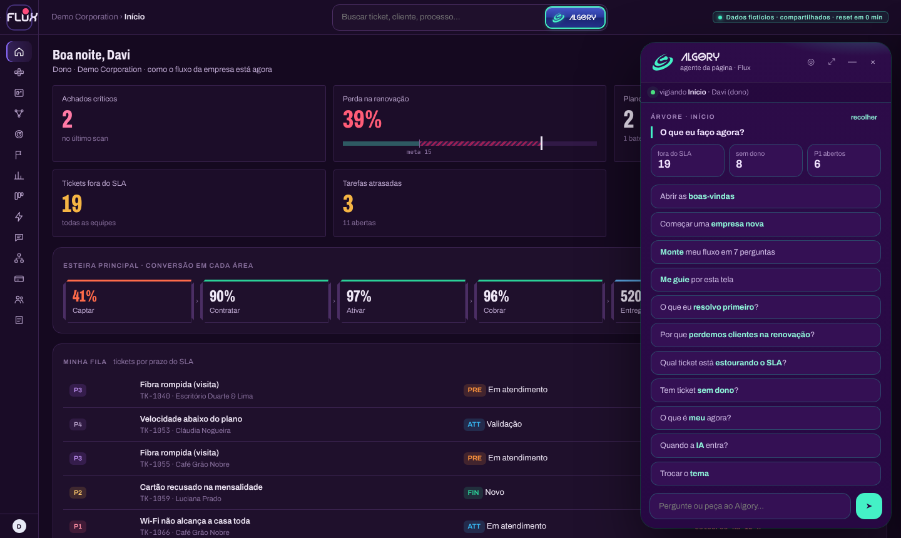
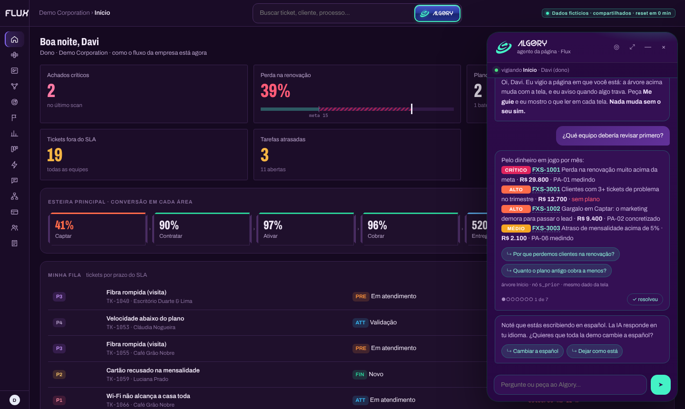
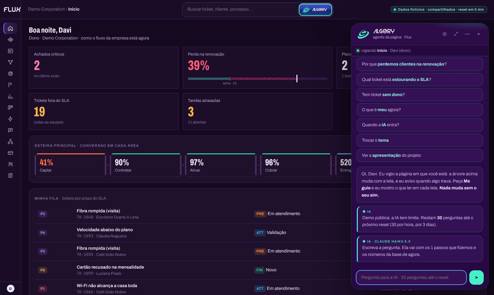

# 7 · Algory, o agente da página

O Algory vive no canto da tela e acompanha a página em que a pessoa está. Ele explica o que cada número significa, leva até a tela onde a ação acontece e, quando a árvore não basta, chama a IA. Ele não muda nada sozinho: explica, sugere e indica onde fazer.

## Princípios

1. **A árvore vem antes do modelo.** Quase toda dúvida de uma demo cabe numa árvore de perguntas que lê a base. Isso não custa token e responde na hora.
2. **Números vêm do banco.** As respostas da árvore e o contexto mandado para a IA saem do motor de medição, o mesmo das telas. A IA é proibida de inventar número.
3. **O Algory não executa.** Ele diz em qual tela a pessoa faz a ação; quem decide é ela.
4. **Custo é gestão.** A IA tem verba, limite por visitante e reserva, como qualquer outra despesa.

## Como ele responde

| | Caminho | Usa modelo |
|---|---|---|
| 1 | Árvore da tela: perguntas prontas que mudam conforme a página | não |
| 2 | Texto livre que casa com uma pergunta da árvore (em PT, EN ou ES) | não |
| 3 | "Me guie": tutorial assistido, tela por tela | não |
| 4 | Pergunta à IA, depois de percorrer a árvore (no máximo 7 passos) | sim |
| 5 | "Algory monta o fluxo": questionário que vira rascunho de processo | sim |

A IA só entra depois da árvore. O botão de perguntar à IA aparece quando a pessoa já percorreu a árvore e ela não resolveu, e a pergunta vai junto com os passos feitos.

## O tutorial assistido

No "Me guie", o Algory some enquanto a página rola até o ponto de ajuda e aparece de novo quando ela para. Assim ele nunca fica na frente do que está explicando nem quebra durante o movimento.

## O que vai para a IA

- o texto da pergunta, limpo e cortado em 400 caracteres, marcado como fala do visitante;
- a tela atual;
- os textos dos passos da árvore (sem os códigos internos dos nós);
- os números da base naquele momento.

As regras fixas pedem resposta curta, no idioma da pergunta, só com os números do contexto, citando as telas pelo nome do menu e ignorando pedidos para mudar as regras ou falar de outro assunto.

No "Algory monta o fluxo", a IA devolve só um JSON com etapas e ligações. O servidor confere o formato, a quantidade de etapas e as ligações antes de mostrar; se não passar, nada é criado.

## Idioma

O servidor detecta se a pergunta está em português, inglês ou espanhol e manda isso explícito para o modelo, com a ordem de responder só nesse idioma. Sem isso, os dados em português puxavam a resposta para o português: no teste, uma pergunta em espanhol voltou quase toda em português. Com a regra explícita, voltou em espanhol.

Se a pessoa escreve num idioma diferente do da demo, o Algory avisa uma vez, no idioma dela, e pergunta se quer trocar a demo inteira.

## Gestão dos tokens

A demo é pública e cada token sai do meu bolso, então o uso é tratado como despesa com orçamento.

| | |
|---|---|
| Modelo principal | Claude Haiku, pela camada compatível com OpenAI da Anthropic |
| Reserva | Groq (gpt-oss) e depois Gemini; quando tudo acaba, a árvore continua respondendo |
| Por visitante | 30 perguntas a cada hora cheia, durante 3 dias a partir do primeiro uso |
| Verba | US$ 5 por mês, liberada em partes diárias que acumulam até no máximo US$ 3 disponíveis de uma vez |
| Reserva por visitante | 5 perguntas por dia e 60 no total da demo por dia, com teto mensal próprio |
| Custo medido | tokens de entrada e saída de cada resposta, gravados com o modelo que respondeu |
| Falha | erro que não é de cota tira o Claude por 1 hora e a reserva assume; erro de cota passa só aquela pergunta para a reserva |
| Concorrência | no máximo 2 chamadas ao mesmo tempo |

O visitante vê o limite: a saudação diz quantas perguntas restam até o próximo reset, cada resposta mostra o modelo que respondeu e o contador, e quando um limite acaba (hora, verba ou 3 dias) o aviso aparece uma vez e diz quem continua respondendo.

Os contadores ficam numa parte do banco que o reset de hora em hora não apaga. O endereço IP nunca é guardado: só um hash com segredo.

Medido no servidor com o modelo real: respostas em 2,5 a 3,3 s, rascunho de fluxo em 5,8 s, perto de US$ 0,0003 por resposta nos preços configurados.

## Segurança

- A pergunta do visitante vai marcada como fala de visitante, e as regras mandam ignorar instruções que estejam nela.
- O cargo vem da sessão no servidor; a IA não decide permissão nenhuma.
- A IA não tem ferramentas: ela só devolve texto, ou um JSON que o servidor confere.
- Chaves só no `.env` do servidor. A página nunca fala com o provedor de IA.

## Rotas

| Rota | Para quê |
|---|---|
| `GET /api/algory/uso` | se a IA está ligada, qual modelo responde agora e quanto resta para este visitante |
| `POST /api/algory` | pergunta (`tipo: pergunta`) ou rascunho de fluxo (`tipo: fluxo`) |
| `GET /api/analise` | medição da base (a mesma das telas), recalculada no máximo a cada 5 s |
